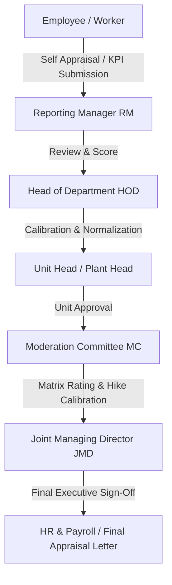

# Performance Management System (PMS)

An enterprise-grade, multi-tier **Performance Management & Appraisal System** built on ASP.NET Core MVC and Microsoft SQL Server. This module orchestrates end-to-end performance planning, KRA/KPI metric evaluations, multi-tier organizational review hierarchies, rating matrices, and moderation committee approvals for both white-collar and blue-collar workforces.

---

## 🌟 Key Features & Capabilities

### 1. White-Collar Performance Management System (`/PMS`)
* **Perspective & Goal Alignment (PMP / KRA / KPI)**:
  * **PMP (Performance Management Perspective)**: Financial, Customer, Internal Business Process, and Learning & Growth.
  * **KRA (Key Result Areas)**: Functional departmental goals tied directly to organizational milestones.
  * **KPI (Key Performance Indicators)**: Measurable metrics with customizable target weights, thresholds, formulas, and units of measure.
* **Hierarchical Multi-Level Appraisal Workflow**:
  * **Level 1 — Self Appraisal (`EmployeeDashboard` / `AppraisalFill`)**: Employees submit self-ratings, quantitative achievements, key accomplishments, and areas for growth.
  * **Level 2 — Reporting Manager Review (`RmDashboard`)**: Managers evaluate submissions against KPIs, provide normalized scores, and submit qualitative feedback.
  * **Level 3 — Head of Department Review (`HodDashboard`)**: HOD review, departmental benchmarking, and calibration.
  * **Level 4 — Unit Head Evaluation (`UnitHeadDashboard`)**: Plant/Unit-level review, ensuring alignment across operations.
  * **Level 5 — Moderation Committee & JMD (`ModCommitteeDashboard` / `JmdDashboard`)**: Top-level executive moderation, rating matrix distribution, and final hike / promotion sign-off.
  * **Level 6 — Super Admin Control (`SuperAdminDashboard`)**: Master cycle configuration, stage rollback/overrides, role reassignment, and audit tracking.
* **Rating Matrix & Compensation Alignment**:
  * Configurable hike matrices linked with base ratings (`PAS_RatingMasterVersion`, `PAS_BasePercentageMaster`).
  * Real-time calculation of increments, incentive allocations, and bonus sync.
* **Executive Reports & Printable Statements**:
  * Pixel-perfect printable appraisal review sheets (`PrintAppraisal.cshtml`).
  * Combined annual performance and business achievement statements (`AnnualReportPMSandBA.cshtml`).

---

### 2. Blue-Collar Performance Management System (`/PMS_BlueCollar`)
* Designed specifically for shop floor, operations, maintenance, and factory workforce.
* Operational evaluation metrics:
  * Safety compliance, machine handling, production downtime, and scrap reduction.
  * Attendance integrity, punctuality, and discipline.
  * Job skill versatility, 5S adherence, and shift performance.
* Role-based interfaces:
  * **HR Dashboard (`HRDashboard.cshtml`)**: Bulk status tracking, pending audit listings, and completion metrics.
  * **Reporting Manager & HOD Evaluations (`RMForm.cshtml`, `HODForm.cshtml`)**: Streamlined numerical & checkbox ratings designed for rapid assessment.
  * **MC & Executive Dashboard (`MCJMDDashboard.cshtml`)**: Unified overview for management decisions.
  * **Printable Record Sheets (`Print.cshtml`)**: Formal physical records for employee personnel files.

---

### 3. Background Services & Automation
* **`PmsAdvancementService`**: Automated promotion of appraisal cycles and synchronization with bonus/allowance (BA) modules.
* **`PmsBaSyncService`**: Seamless reviewer synchronization and change audit logging.
* **`PmsReminderService`**: Hangfire-scheduled notifications and pending-review email alerts to managers and reviewers.

---

## 📁 Repository Structure

```
Performance-Management-System/
├── README.md
├── Controllers/
│   ├── PMSController.cs                 # Main PMS business logic & review workflow engine
│   └── PMS_BlueCollarController.cs      # Blue-collar operational workforce appraisal controller
├── Models/
│   ├── PmsIndexVM.cs                    # Comprehensive ViewModels: PMP, KRA, KPI, and Audit VMs
│   └── PMSBlueCollarModel.cs            # ViewModels for Blue-Collar forms, tracking, and dashboard
├── Services/
│   ├── PmsAdvancementService.cs         # Cycle advancement & automated stage progression
│   ├── PmsBaSyncService.cs              # Reviewer sync and audit logging service
│   └── PmsReminderService.cs            # Hangfire background reminder service
├── Views/
│   ├── PMS/
│   │   ├── Index.cshtml                 # Main PMS overview & cycle entry
│   │   ├── EmployeeDashboard.cshtml     # Employee self-appraisal portal
│   │   ├── RmDashboard.cshtml           # Reporting Manager assessment dashboard
│   │   ├── HodDashboard.cshtml          # HOD calibration and evaluation
│   │   ├── UnitHeadDashboard.cshtml     # Unit Head executive view
│   │   ├── ModCommitteeDashboard.cshtml # Moderation Committee adjustments
│   │   ├── JmdDashboard.cshtml          # JMD final approval & sign-off
│   │   ├── SuperAdminDashboard.cshtml   # Administration & cycle controls
│   │   ├── AppraisalFill.cshtml         # KPI scoring & evaluation form
│   │   ├── PrintAppraisal.cshtml        # Formal appraisal print template
│   │   └── AnnualReportPMSandBA.cshtml  # Annual consolidated report
│   └── PMS_BlueCollar/
│       ├── Index.cshtml                 # Blue-collar module index
│       ├── Create.cshtml                # New blue-collar assessment
│       ├── Edit.cshtml                  # Edit assessment
│       ├── HRDashboard.cshtml           # HR overview & bulk tracker
│       ├── RMDashboard.cshtml           # Manager assessment overview
│       ├── RMForm.cshtml                # Manager evaluation entry
│       ├── HODDashboard.cshtml          # HOD dashboard
│       ├── HODForm.cshtml               # HOD evaluation entry
│       ├── MCJMDDashboard.cshtml        # Moderation Committee dashboard
│       ├── Tracking.cshtml              # Stage tracking & audit
│       └── Print.cshtml                 # Printable form
└── Database/
    ├── PMS_Database_Schema_And_Migrations.sql # Tables, audit columns, and indexes
    └── SP_GetMonthlyPaymentStatement.sql      # Stored procedures for compensation queries
```

---

## 👥 Role Hierarchy & Review Stages



| Role | PMS Scope | Actions Available |
| :--- | :--- | :--- |
| **Employee** | Self | View assigned KPIs, submit achievements & ratings |
| **Reporting Manager** | Direct Reportees | Review self-scores, assign manager ratings, add recommendations |
| **HOD** | Department | Normalize manager ratings, assess department-wide bell curve |
| **Unit Head** | Plant / Business Unit | Unit-level review, ensure departmental equity |
| **Moderation Committee** | Company-wide | Rating normalization, hike percentage distribution, anomaly corrections |
| **JMD / Director** | Company-wide | Final sign-off on promotions, increments, and grades |
| **SuperAdmin** | System | Reassign reviewers, unlock completed stages, view full audit logs |

---

## 🛠️ Integration & Technical Stack

* **Framework**: ASP.NET Core MVC (.NET 8 / .NET 9)
* **Language**: C#
* **Frontend**: Razor View Engine, Vanilla CSS, Responsive Tables & Modal Dialogs
* **Database**: Microsoft SQL Server (Stored Procedures, Table-Valued Parameters, Dynamic Auditing)
* **Job Scheduler**: Hangfire (Recurring reminder dispatch, cycle rollover)
* **Authentication & Authorization**: ASP.NET Core Identity (Role-based policies)

### Dependency Injection Setup

To register the PMS services in `Program.cs`:

```csharp
// Register PMS Services
builder.Services.AddScoped<IPmsAdvancementService, PmsAdvancementService>();
builder.Services.AddScoped<IPmsBaSyncService, PmsBaSyncService>();
builder.Services.AddScoped<IPmsReminderService, PmsReminderService>();

// Register Recurring Job in Hangfire
RecurringJob.AddOrUpdate<IPmsReminderService>(
    "pms-reminders",
    service => service.CheckAndSendPendingReminders(),
    Cron.Daily(9, 0) // Daily at 9:00 AM
);
```

---

## 🔒 Security & Data Integrity
* Audit trail tracking (`CreatedBy`, `CreatedAt`, `ModifiedBy`, `ModifiedOn`, `DeletedBy`).
* Soft-delete implementation (`IsDeleted`) to preserve historical appraisal records for compliance.
* Role-gated controller endpoints using `[Authorize(Roles = "...")]` attributes.
